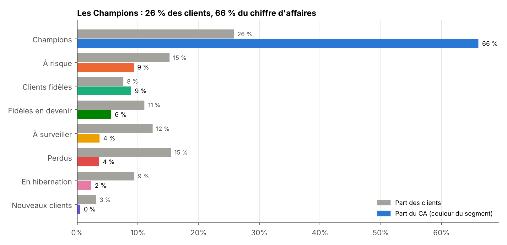
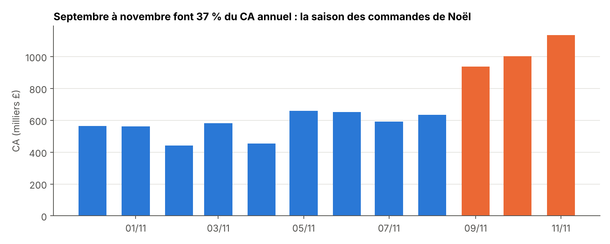
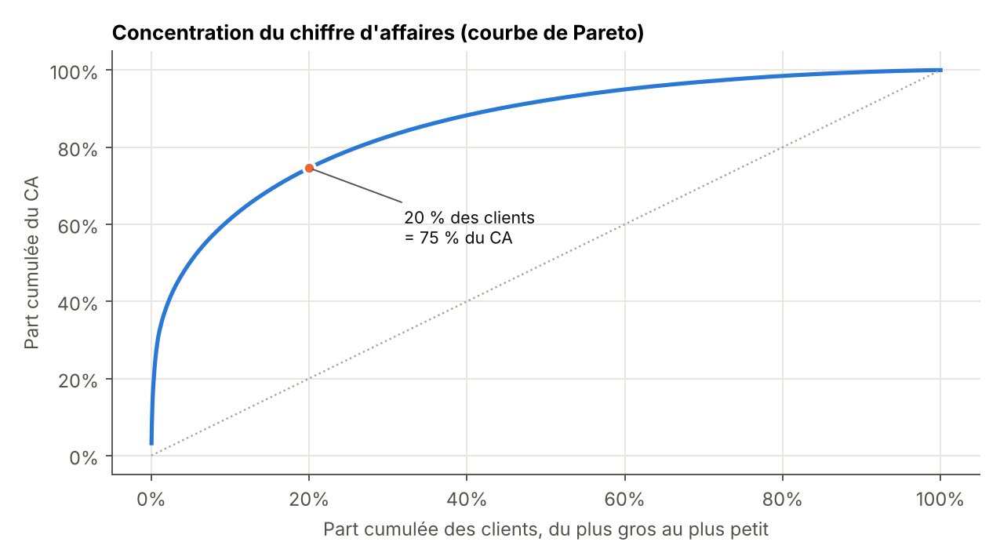
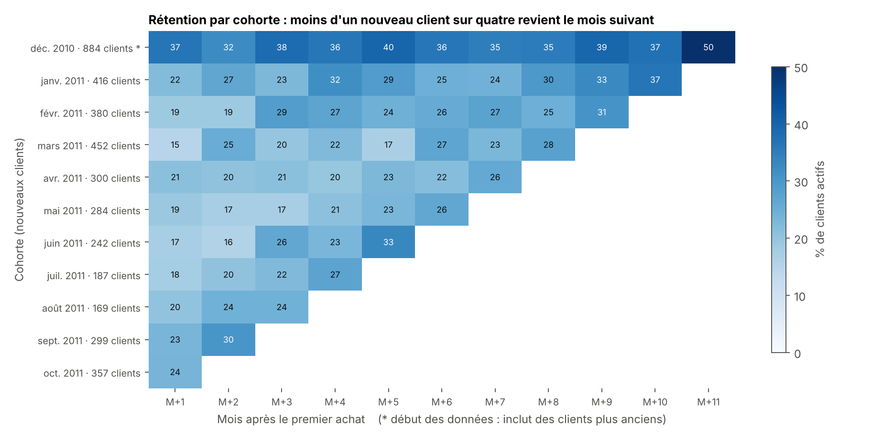

# Segmentation clients RFM : à qui parler, et avec quel message ?

**Python (pandas, matplotlib) · RFM · analyse de cohortes · courbe de Pareto**

> - **Le problème :** un grossiste en ligne d'articles cadeaux (Royaume-Uni) envoie les mêmes campagnes à ses 4 300 clients. Lesquels faut-il fidéliser, relancer ou laisser partir ?
> - **Les données :** 541 909 lignes de factures réelles (décembre 2010 à décembre 2011), base publique « Online Retail » de l'UCI.
> - **La méthode :** nettoyage documenté, scores RFM (Récence, Fréquence, Montant) en quintiles, 8 segments d'action, rétention par cohorte mensuelle.
> - **Le résultat :** 26 % des clients font 66 % du chiffre d'affaires. 657 clients « à risque » pèsent 813 000 £ et sont en train de décrocher. Moins d'un nouveau client sur quatre revient le mois suivant.



---

## 1. Nettoyage : chaque ligne retirée est justifiée

| Étape | Lignes restantes |
|---|---|
| Lignes brutes | 541 909 |
| Doublons exacts supprimés | 536 641 |
| Factures d'annulation (préfixe « C ») retirées | 527 390 |
| Quantités ou prix nuls ou négatifs retirés | 524 878 |
| Frais de port, remises et frais bancaires retirés (codes POST, DOT, M, D…) | 522 504 |
| Lignes sans identifiant client retirées | **391 150** |

Les lignes sans identifiant client représentent 1,5 M£ de ventes, soit environ 15 % du CA. Elles ne peuvent pas être rattachées à un client et sont donc exclues de la segmentation. **Recommandation :** imposer l'identification au moment de la commande, sinon près de 15 % du chiffre d'affaires reste invisible pour le marketing.

## 2. Une activité très saisonnière



Les commandes de Noël passées par les revendeurs entre septembre et novembre font **37 % du CA annuel**. Le calendrier des campagnes doit en tenir compte : il faut réactiver les clients en août, pas en novembre.

## 3. Segmentation RFM

Chaque client reçoit trois notes de 1 à 5 (quintiles) : **R**écence du dernier achat, **F**réquence (nombre de commandes) et **M**ontant total. Les combinaisons R × F définissent 8 segments d'action.

| Segment | Clients | Part des clients | Part du CA | Dernier achat (médiane) | Commandes (moyenne) | Action recommandée |
|---|---|---|---|---|---|---|
| **Champions** | 1 117 | 26 % | **66 %** | 10 jours | 10,0 | Programme VIP, accès anticipé aux collections de Noël, pas de remise inutile |
| Clients fidèles | 329 | 8 % | 9 % | 46 jours | 5,6 | Ventes croisées, offre de montée en gamme |
| Fidèles en devenir | 481 | 11 % | 6 % | 17 jours | 2,0 | Relance après le 2e achat, offre sur la 3e commande |
| Nouveaux clients | 136 | 3 % | 0,5 % | 18 jours | 1,0 | Parcours d'accueil, 2e commande sous 30 jours |
| À surveiller | 537 | 12 % | 4 % | 52 jours | 1,6 | Rappel personnalisé avant décrochage |
| **À risque** | 657 | 15 % | **9 %** | 131 jours | 3,4 | **Priorité n° 1** : campagne de reconquête, appel commercial pour les plus gros |
| En hibernation | 408 | 9 % | 2 % | 113 jours | 1,2 | Une relance automatique à faible coût |
| Perdus | 669 | 15 % | 4 % | 274 jours | 1,1 | Ne plus investir, sauf campagne de saison |

**Le segment « À risque » est l'enjeu caché.** Ces clients achetaient régulièrement (3,4 commandes en moyenne) et ont représenté 813 000 £. Ils n'ont rien commandé depuis plus de 4 mois. Les relancer coûte bien moins cher que d'acquérir de nouveaux clients.

## 4. Concentration du chiffre d'affaires



**20 % des clients font 75 % du CA.** Perdre un seul gros compte pèse donc lourd. Je recommande un suivi individuel des 100 premiers clients, avec une alerte dès qu'un délai de réachat dépasse leur rythme habituel.

## 5. Rétention par cohorte



- **Seuls 15 à 24 % des nouveaux clients reviennent le mois suivant.** L'enjeu porte sur la deuxième commande.
- **La rétention remonte à M+9, M+10 et M+11 pour les cohortes du début d'année.** Ces clients reviennent pour la saison de Noël : c'est un comportement saisonnier, pas une fidélisation.
- La cohorte de décembre 2010 retient mieux (35 à 40 %). C'est un biais de lecture : les données démarrent ce mois-là, donc elle contient aussi des clients plus anciens et déjà fidèles.

## Recommandations

1. **Lancer une campagne de reconquête sur les 657 clients à risque.** Commencer par ceux dont le montant est le plus élevé, avec une prise de contact directe pour le premier décile.
2. **Protéger les Champions** par un service plutôt que par des remises. Ils achètent déjà sans incitation.
3. **Travailler la deuxième commande** des nouveaux clients, avec un parcours automatisé sur 30 jours.
4. **Avancer les campagnes saisonnières en août**, avant le pic de septembre à novembre.
5. **Rendre l'identification client obligatoire.** Aujourd'hui, 15 % du CA échappe à toute analyse.

---

## Reproduire l'analyse

```bash
pip install -r requirements.txt
python src/telecharger_donnees.py   # 45 Mo, miroir GitHub du jeu UCI
python src/rfm.py                   # nettoyage, RFM, cohortes, figures, résultats
```

```
├── src/
│   ├── telecharger_donnees.py
│   └── rfm.py                         # nettoyage, scores, segments, cohortes, figures
├── resultats/
│   ├── journal_nettoyage.csv
│   ├── scores_rfm_par_client.csv      # score R, F, M et segment pour chaque client
│   ├── synthese_segments.csv
│   └── retention_cohortes.csv
└── figures/
```

**Livrable réutilisable :** `scores_rfm_par_client.csv` s'importe directement dans un CRM ou un outil d'e-mailing pour cibler chaque segment.

**Données :** Daqing Chen, *Online Retail* (2015), UCI Machine Learning Repository, licence CC BY 4.0.

---

**Emmanuel Noualeu**, analyste de données et ingénieur minier · [Portfolio](https://emmanuelnoualeu.github.io) · [LinkedIn](https://www.linkedin.com/in/emmanuel-noualeu-b78bba24b/) · [Upwork](https://www.upwork.com/freelancers/~0146b1a5dfeefdd395) · [emmanuelnoualeu@gmail.com](mailto:emmanuelnoualeu@gmail.com)
